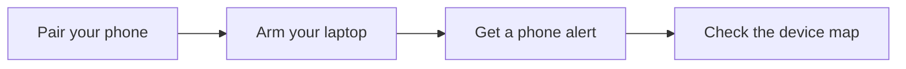

# WATSafe

**A laptop protection app with a phone companion.**

WATSafe is built for the moment you step away from your laptop in a library, café, or shared workspace. Arm it before you leave. If the laptop moves or its camera monitoring is interrupted, WATSafe can sound a siren and alert your phone.

## Demo

## Highlights

- **Movement detection** looks for signs the laptop itself moved and aims to ignore people walking past.
- **Camera tamper detection** responds to sustained obstruction or loss of camera capture. Camera frames are processed on the laptop.
- **Lid-close and connection alerts** can warn you before an armed laptop goes to sleep or when it stops checking in. A sleeping laptop cannot keep playing its siren.
- **Phone notifications** open the affected device on the map. Pair once by scanning a QR code with the iPhone or Android web companion.
- **Device map** shows reported laptop and phone locations with timestamps and an estimate of accuracy.
- **PIN and themes** let you disarm protection with your PIN and choose from six themes on desktop and phone.

## How it works

## Built with

**Flutter** for the desktop app, native **Swift** and **C++** for desktop integrations, and a **Dart** relay with **PostgreSQL** for pairing and alerts. The phone companion uses **Web Push** and displays **OpenStreetMap** tiles.
