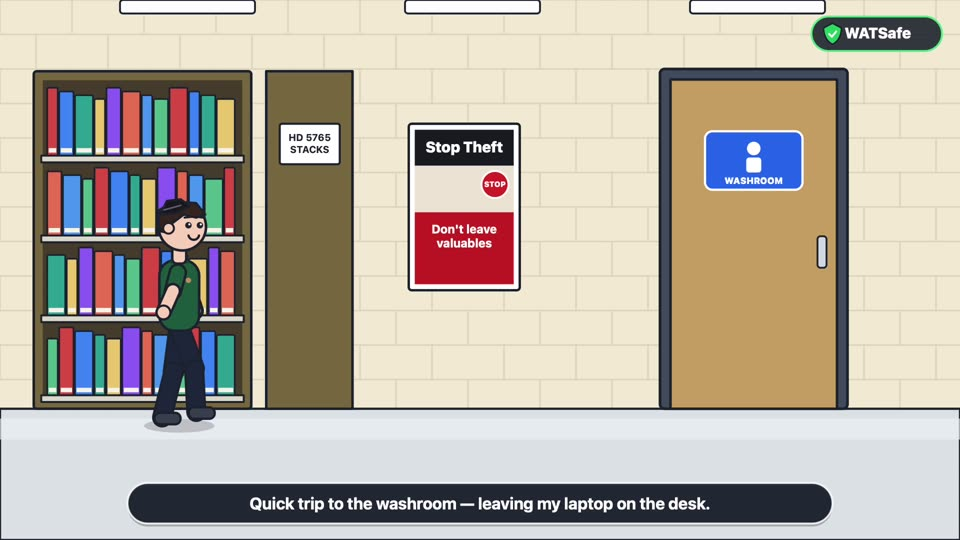

<h1 align="center">WATSafe</h1>

<strong>Arm your laptop. Get alerted on your phone.</strong>

WATSafe helps protect an unattended laptop by detecting movement and camera tampering. If something happens while it's armed, it can sound a siren and send a notification to your paired phone.

**[▶ Watch the 30-second demo](assets/demo/WATSafe.mp4?raw=true)**

*The animation shows a library scenario. The app displays reported device locations and their accuracy on a map. It does not pinpoint a device to a room or shelf indoors.*

## What WATSafe does

| Feature | What you get |
| --- | --- |
| **Movement detection** | Arm your laptop before stepping away. WATSafe looks for signs that the laptop itself has moved and aims to ignore people simply walking past. |
| **Camera tamper alerts** | Sustained obstruction or loss of camera capture while armed can trigger a siren and a phone alert. |
| **Lid-close and connection alerts** | WATSafe attempts to alert your phone before an armed laptop sleeps. If the laptop stops checking in, the relay can send a separate warning. |
| **Phone notifications** | Pair by QR code and enable notifications in the Home Screen companion. Tap an alert to open the affected device on the map. |
| **Device map** | See the laptop and phone on the same map when both share location. Accuracy and timestamps help you distinguish a recent fix from a last-known position. |
| **PIN and appearance** | Disarm with your PIN and choose from six themes on desktop and phone. |

## How it works

**Pair your phone → Arm your laptop → Get an alert → Check the map**

The laptop app runs on **macOS and Windows**. The companion installs from the browser on **iPhone and Android**. Camera frames are processed locally, and precise coordinates stay out of lock-screen notifications.

A sleeping laptop cannot keep sounding its siren or reporting new locations. Remote alerts depend on the relay and push delivery.
