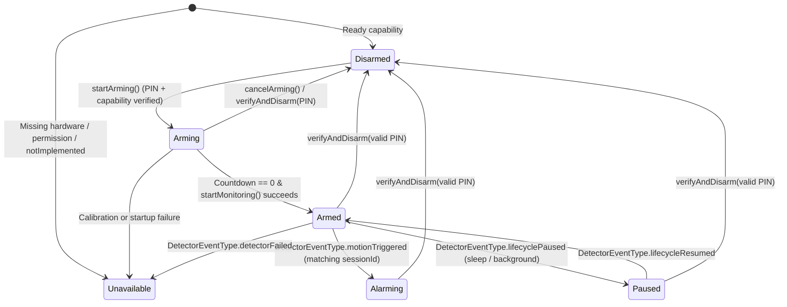

# WATSafe Architecture

WATSafe is a cross-platform device protection application built with Flutter and Dart for shared UI and state management, paired with native platform adapters for hardware sensors, camera capture, audio output, and secure credential storage.

---

## 1. Repository & Module Boundaries

```text
WATSafe/
├── lib/
│   ├── main.dart                          # App bootstrap & dependency wiring
│   ├── core/
│   │   ├── alarm/
│   │   │   ├── alarm_state.dart           # Explicit ProtectionState enum
│   │   │   └── alarm_controller.dart      # Central protection state machine
│   │   ├── contracts/
│   │   │   └── platform_contracts.dart    # Typed interfaces for detectors & services
│   │   └── models/
│   │       ├── detector_models.dart       # Capabilities, permissions, events, config
│   │       ├── incident_models.dart       # Metadata-only local incident records
│   │       └── settings_models.dart       # Sensitivity, countdown, volume settings
│   ├── features/
│   │   ├── alarm/                         # ActiveAlarmScreen & PIN disarm dialog
│   │   ├── dashboard/                     # Protection Dashboard & detector selector
│   │   ├── incidents/                     # Local Incident History screen
│   │   ├── onboarding/                    # First-run PIN setup & capability check
│   │   ├── paired_devices/                # Honest unconfigured Paired Devices view
│   │   ├── settings/                      # Sensitivity, countdown, volume, Change PIN
│   │   ├── shell/                         # Adaptive Material 3 NavigationRail/Bar
│   │   └── theme/                         # Charcoal/off-white/amber theme & shield art
│   ├── platform/
│   │   ├── platform_detector_registry.dart
│   │   ├── desktop/
│   │   │   ├── macos_camera_detector.dart # Real AVFoundation channel adapter
│   │   │   └── windows_detectors.dart     # Windows accelerometer & camera contracts
│   │   └── mobile/
│   │       ├── android_motion_detector.dart
│   │       └── ios_motion_detector.dart
│   └── services/
│       ├── audio_alarm_service.dart       # Bundled WAV looping siren adapter
│       ├── local_storage_service.dart     # JSON incident & settings persistence
│       ├── pin_security_service.dart      # PBKDF2-HMAC-SHA256 & lockout backoff
│       ├── remote_notification_service.dart
│       └── secure_pin_storage_service.dart
├── macos/Runner/
│   └── MainFlutterWindow.swift            # Native AVFoundation, AVAudioPlayer, Keychain
├── windows/                               # Windows C++ runner
├── ios/                                   # iOS Swift runner
├── android/                               # Android Kotlin runner
├── backend/README.md                      # Future backend & APNs/FCM specification
└── docs/                                  # Architecture, capabilities, workflow, roadmap
```

---

## 2. Central Alarm State Machine (`AlarmController`)

`AlarmController` (`lib/core/alarm/alarm_controller.dart`) is the single source of truth for protection state.



### Key State Machine Invariants

1. **Session-Scoped Event Filtering:** Every arming attempt generates a monotonic `sessionId` (`session_<seq>_<epochMs>`). Countdown callbacks and `DetectorEvent`s carrying a `sessionId` that does not match `_activeSessionId` are strictly ignored.
2. **Single-Incident Deduplication:** Once a session enters `ProtectionState.alarming`, subsequent `motionTriggered` events update `peakMotionScore` on the active incident rather than spawning duplicate incidents or restarting the audio player.
3. **Immediate Local Siren:** Upon entering `alarming`, `audioAdapter.startLoopingAlarm()` is invoked before awaiting local disk writes or remote notification calls. Failures in `incidentStorage` or `notificationAdapter` surface non-fatal warnings without stopping the siren.
4. **Honest Status Representation:** `ProtectionState.armed` ("Protected") is only shown when a real detector is actively monitoring. If a detector fails mid-session (`detectorFailed`) or pauses for system sleep (`lifecyclePaused`), the controller immediately transitions out of `armed` to `unavailable` or `paused`.

---

## 3. PIN Cryptography & Secure Storage

`PinSecurityService` (`lib/services/pin_security_service.dart`):

- Enforces numeric PINs of **6 to 12 digits** with confirmation matching.
- Generates a 16-byte cryptographic random salt (`Random.secure()`) and derives a 256-bit hash using **PBKDF2-HMAC-SHA256** (`20,000` iterations in production) via `package:cryptography`.
- Compares candidate hashes in constant time.
- Applies stepped lockout delays on consecutive failed attempts (`0s` -> `2s` -> `5s` -> `10s` -> `30s`).
- Requires verifying the current PIN before permitting a PIN change.
- Persists only the salt, iteration count, and derived hash via `PlatformSecurePinStorage` (`dev.watsafe/secure_storage`), which writes to the macOS Security Keychain (`SecItemAdd`) alongside a `0600` restricted fallback in `~/Library/Application Support/dev.watsafe.temp.watsafe/` so ad-hoc signed local builds work without a paid Apple Developer provisioning profile.

---

## 4. macOS Webcam Scene-Motion Detection Pipeline

Because macOS does not expose a MacBook accelerometer through `CMMotionManager`, the initial desktop hardware integration uses local optical scene-motion detection via `AVFoundation` (`macos/Runner/MainFlutterWindow.swift`).

1. **Permission & Discovery:** Queries `AVCaptureDevice.authorizationStatus(for: .video)` and `AVCaptureDevice.DiscoverySession`. Requests permission via `AVCaptureDevice.requestAccess(for: .video)` when initiated by the user.
2. **Off-Thread Capture & Downsampling:** `AVCaptureVideoDataOutput` delivers `32BGRA` pixel buffers on a dedicated serial background queue (`dev.watsafe.camera.motion`). Frames are throttled to ~8 FPS and downsampled to a `64x48` grayscale grid (`Y = (77*R + 150*G + 29*B) >> 8`).
3. **Startup Calibration & Adaptive Reference:** During the initial calibration window (`1.5s`), frames blend into a floating-point baseline grid (`referenceGrid`). After calibration, the baseline adapts slowly (`alpha = 0.08`) to gradual ambient lighting shifts.
4. **Normalized Motion Score & Persistence Filter:**
   $$\text{motionScore} = \frac{1}{W \cdot H \cdot 255} \sum_{i=1}^{W \cdot H} \left| Y_t(i) - R_t(i) \right|$$
   User sensitivity (`0.20`..`0.90`) maps to a threshold in `[0.035, 0.175]`. At least `3` consecutive frames must exceed `motionThreshold` before `motionTriggered` is emitted.
5. **Poor Input Detection:** If mean luminance drops below `2.5%` or pixel deviation drops below `0.7%` for 8 consecutive frames (e.g., closed camera privacy shutter or pitch-black room), the bridge emits `poorInputWarning` and marks capability as `degraded`.
6. **Future Improvement — Optical Flow Ego-Motion:** The current algorithm measures *scene motion* (reacting to people walking past, lighting shifts, or laptop movement). A planned enhancement in `docs/roadmap.md` will estimate global camera translation/rotation via sparse Lucas-Kanade optical flow to distinguish physical laptop movement from background passersby.
